  

  
  
  
  
  
  

---

# 🚀 Awesome Quantized Model Inference & FP4 Optimization

> **A comprehensive, SEO-optimized, community-curated index of production-ready SaaS platforms, cloud inference engines, and open-source frameworks pioneering low-bit quantization (NVFP4, MXFP4, INT4, FP8, AWQ, GPTQ) and high-throughput LLM serving.**

**Last updated: November 2026** 📅

This repository tracks notable **cloud SaaS platforms** and **open-source repositories** for **Quantized Model Inference & FP4 Optimization**. These cutting-edge tools maximize LLM, VLM, and multimodal generative throughput while drastically cutting VRAM requirements using 4-bit floating-point formats (`NVFP4`, `MXFP4`), weight-only/activation quantization (`AWQ`, `GPTQ`, `FP8`, `GGUF`), speculative decoding (`EAGLE`, `Medusa`), and fused attention/GEMM kernels (`Marlin`, `FlashInfer`, `FlashAttention`).

---

## 📑 Table of Contents
- [🌐 Sector Overview & Market Dynamics](#-sector-overview--market-dynamics)
- [☁️ SaaS & Hosted Inference Platforms](#️-saas--hosted-inference-platforms)
- [💻 Open-Source GitHub Projects](#-open-source-github-projects)
- [🛠️ How to Contribute](#️-how-to-contribute)
- [💖 Support & Sponsorship](#-support--sponsorship)
- [📈 Star History](#-star-history)
- [⚠️ Disclaimer](#️-disclaimer)

---

## 🌐 Sector Overview & Market Dynamics

The AI inference infrastructure and hardware-accelerated serving market is projected to expand from **$15 billion in 2024 to over $110 billion by 2030** (growing at a ~38% CAGR), rapidly eclipsing AI model training expenditure as enterprise deployment moves into real-time production. The sector exhibits **moderate fragmentation with emergent winner-take-most dynamics**: foundational hardware and compiler microservices remain heavily consolidated around NVIDIA (Blackwell/Hopper architecture and CUDA ecosystem), while the cloud API serving layer features aggressive contestation between hyperscalers, custom silicon providers (e.g., Groq LPUs, SambaNova RDUs), and independent low-latency serverless clouds (Fireworks AI, Together AI, Modal, Baseten).

---

## ☁️ SaaS & Hosted Inference Platforms

The following SaaS platforms offer managed low-bit inference APIs, custom FP4/FP8 runtime acceleration, and autoscaling GPU microservices. Entries are sorted descending by company size (valuation / market capitalization / revenue).

| 🏢 Platform | 💰 Company Size (Valuation / Revenue) | 🏷️ Starting Tier Price | 🎁 Free Tier Limits | 🔍 Core Specialization & FP4/Low-Bit Highlights |
| :--- | :--- | :--- | :--- | :--- |
| **[NVIDIA NIM & TensorRT Cloud](https://nvidia.com)** | **~$3.5 Trillion** Market Cap (NVIDIA) | **$1.00 / GPU-hour** (NVIDIA AI Enterprise starts at $4,500/GPU/year or $1.00/GPU-hr on cloud) | **Dynamic Free Tier** (~40 RPM rate limit across hosted model catalog via NVIDIA Developer Program at `build.nvidia.com`, no credit card required) | Enterprise microservices featuring pre-optimized TensorRT-LLM engines with native Blackwell NVFP4, Hopper FP8, and SmoothQuant acceleration. |
| **[Fireworks AI](https://fireworks.ai)** | **$17.5 Billion** Valuation ($1B+ ARR) | **$0.15 / 1M input tokens** (Flash/small models; standard models scale $0.50-$2.00/1M tokens) | **$1.00 Free Trial Credit** (Instant signup credit without upfront credit card, subject to ~10 RPM ceiling until billing profile verified) | Ultra-low-latency generative inference cloud powered by custom quantized CUDA kernels (`FireAttention`), speculative decoding, and FP4/FP8 pipelines. |
| **[Modal](https://modal.com)** | **$15.75 Billion** Valuation ($1B+ ARR) | **$0.0000028 / vCPU-sec** (~$0.01/hr CPU, GPUs starting at $0.15/hr T4 up to H100s, pay-per-second) | **$30.00 / month Recurring Free Credits** on Starter Plan (Max 10 concurrent GPUs, 100 containers, 3 workspace seats; resets monthly) | High-performance serverless Python infrastructure running containerized vLLM, SGLang, TensorRT-LLM, and custom FP4/CUDA kernels on demand. |
| **[SambaNova Cloud](https://sambanova.ai)** | **$11.0 Billion** Valuation | **$0.10 / 1M input tokens** (Pay-as-you-go Developer tier; Llama-3.1 70B starting at $0.60/1M tokens) | **Permanent Free Tier** (20 RPM, 20 RPD, and up to 200,000 tokens/day cap on preview models without entering a payment method) | Native inference cloud running massive quantized models on Reconfigurable Dataflow Units (RDUs) with extreme on-chip SRAM bandwidth. |
| **[Together AI](https://together.ai)** | **$8.3 Billion** Valuation | **$0.18 / 1M input tokens** (Llama 3 8B; requires $15 mandatory initial prepaid deposit, refills min $5) | **No Free Tier / No Trial Credits** (Direct prepaid model; external qualifying early-stage startups can apply for $15,000-$50,000 credits) | High-throughput cloud inference engine utilizing custom FP4/FP8 quantization, FlashAttention kernels, and sub-second token generation. |
| **[Hugging Face Inference Endpoints](https://huggingface.co)** | **$4.5 Billion** Valuation | **$0.06 / hour** (CPU instances; GPU instances start at $0.50/hr for T4, scaling to A100/H100) | **No Dedicated Free Tier** (Paid hourly dedicated instances; accounts get serverless community API rate allowances or $2/mo credit with PRO plan) | Fully managed dedicated model hosting backed by Text Generation Inference (TGI) with built-in BitsAndBytes, AWQ, GPTQ, and Marlin quantization. |
| **[GroqCloud](https://groq.com)** | **$3.5 Billion** Valuation | **$0.05 / 1M input tokens** (Llama 8B; larger 70B models start at $0.59/1M tokens on Developer Plan) | **Permanent Free Tier** (30 RPM, 1,000-14,400 RPD, and 6,000-30,000 TPM depending on model tier, no credit card required) | Hosted Language Processing Unit (LPU) inference platform delivering ultra-high-speed deterministic token generation with hardware low-precision execution. |
| **[Baseten](https://baseten.co)** | **$2.15 Billion** Valuation | **$0.000108 / sec** ($0.39/hr for T4 GPU; A100 at $3.25/hr, pay-per-second compute with $0 monthly platform fee) | **$30.00 One-time Free Trial Credit** (Granted upon initial workspace creation to test model APIs and dedicated deployments before card billing) | Managed model deployment and inference infrastructure offering one-click TensorRT-LLM, vLLM, and FP4/FP8 quantized model autoscaling. |
| **[RunPod Serverless](https://runpod.io)** | **$1.0 Billion** Valuation | **$0.0002 / second** (~$0.20/hr for entry GPUs; Flex serverless starts at $0.00016/sec, storage at $0.05/GB/mo) | **No Permanent Free Tier** (Prepaid pay-per-second compute model; periodic $5-$10 promo vouchers and startup accelerator grants available) | Distributed GPU cloud offering serverless endpoints, vLLM/ExLlama worker templates, and custom Docker execution for quantized GGUF/AWQ models. |
| **[FriendliAI](https://friendli.ai)** | **~$80 Million** Valuation | **$0.20 / 1M input tokens** (Pay-as-you-go serverless model endpoints; dedicated container licenses available) | **Free Starter Access** (Free serverless trial quota provided upon initial registration for testing open-weight models before paid tiers) | Commercial LLM serving engine featuring iteration-level scheduling, custom low-bit CUDA engines, and proprietary FP8/INT4/FP4 quantization. |

---

## 💻 Open-Source GitHub Projects

The open-source community is the driving force behind quantized model inference, delivering state-of-the-art fused CUDA/Triton kernels, post-training quantization (PTQ) algorithms, and production-grade serving architectures. 

Projects below are equipped with live social star badges linking directly to their stargazer pages and are **sorted descending by star counts**.

- **[llama.cpp](https://github.com/ggml-org/llama.cpp)**   
  Premier open-source C/C++ LLM inference engine enabling 1.5-bit to 8-bit GGUF, IQ, and MXFP4 quantized execution across NVIDIA, AMD ROCm, Apple Silicon Metal, and CPUs.

- **[vLLM](https://github.com/vllm-project/vllm)**   
  Industry-standard high-throughput LLM serving engine featuring PagedAttention, native NVFP4/MXFP4, Hopper FP8, AWQ, GPTQ, and Marlin fused kernel integration.

- **[DeepSpeed](https://github.com/deepspeedai/DeepSpeed)**   
  Microsoft's deep learning optimization suite featuring DeepSpeed-FastGen, ZeroQuant, SmoothQuant, and SplitFuse high-throughput quantized inference.

- **[SGLang](https://github.com/sgl-project/sglang)**   
  High-performance serving framework for LLMs and VLMs featuring RadixAttention prefix caching, zero-overhead scheduling, and hardware-accelerated FP4/FP8 quantization.

- **[FlashAttention](https://github.com/Dao-AILab/flash-attention)**   
  Fast, memory-efficient IO-aware exact attention CUDA library accelerating transformer training and low-bit inference runtimes.

- **[MLC-LLM](https://github.com/mlc-ai/mlc-llm)**   
  Universal LLM deployment and machine learning compilation engine compiling 3-bit and 4-bit quantized models natively across WebGPU, iOS, Android, Vulkan, and CUDA.

- **[TensorRT-LLM](https://github.com/NVIDIA/TensorRT-LLM)**   
  NVIDIA's flagship library for defining and serving optimized LLMs with native Blackwell NVFP4, Hopper FP8, in-flight batching, and custom GEMM kernels.

- **[Text Generation Inference (TGI)](https://github.com/huggingface/text-generation-inference)**   
  Production-grade Rust and Python LLM serving container by Hugging Face supporting Marlin, EXL2, AWQ, GPTQ, EETQ, and FP8 quantization out of the box.

- **[BitsAndBytes](https://github.com/bitsandbytes-foundation/bitsandbytes)**   
  Accessible k-bit quantization library for PyTorch enabling 4-bit NormalFloat (NF4), FP4, 8-bit matrix multiplication, and QLoRA fine-tuning.

- **[LMDeploy](https://github.com/InternLM/lmdeploy)**   
  Open-source toolkit by InternLM for compressing, deploying, and serving LLMs and VLMs powered by the TurboMind C++/CUDA engine and W4A16/FP8 quantization.

- **[FlashInfer](https://github.com/flashinfer-ai/flashinfer)**   
  High-performance kernel library engineered for LLM serving, offering specialized FP8/FP4 KV-cache compression, ragged batch decoding, and fused attention.

- **[NVIDIA Model Optimizer](https://github.com/NVIDIA/Model-Optimizer)**   
  Unified library of state-of-the-art model compression techniques (PTQ, QAT, distillation, sparsity) preparing models for TensorRT-LLM and vLLM NVFP4/FP8 deployment.

- **[AutoGPTQ](https://github.com/AutoGPTQ/AutoGPTQ)**   
  Easy-to-use 4-bit post-training quantization package for LLMs with custom CUDA, Marlin, and Triton kernels integrated across the Hugging Face ecosystem.

- **[ExLlamaV2](https://github.com/turboderp-org/exllamav2)**   
  Fast inference engine designed for running EXL2 (mixed 2-to-8 bit precision) and GPTQ quantized models locally with minimal VRAM on modern consumer GPUs.

- **[LLM Compressor](https://github.com/vllm-project/llm-compressor)**   
  State-of-the-art model compression library built directly for production vLLM inference, supporting NVFP4, MXFP4, FP8, INT4, and 2:4 structural sparsity.

- **[AWQ (LLM-AWQ)](https://github.com/mit-han-lab/llm-awq)**   
  MIT HAN Lab's seminal Activation-aware Weight Quantization algorithm for 4-bit LLM compression, preserving outlier activation weights without retraining.

- **[TorchAO](https://github.com/pytorch/ao)**   
  PyTorch native Architecture Optimization library offering first-class `MXFP4`, `INT4`, `FP8`, dynamic quantization, and sparsity kernels compatible with `torch.compile`.

- **[GPTQ-for-LLaMa](https://github.com/qwopqwop200/GPTQ-for-LLaMa)**   
  Pioneering 4-bit post-training quantization implementation for LLaMA-based architectures using approximate second-order weight updates.

- **[EAGLE](https://github.com/SafeAILab/EAGLE)**   
  Leading speculative decoding framework (EAGLE-1, EAGLE-2, and EAGLE-3) accelerating LLM token generation up to 3x without degrading output quality.

- **[AutoAWQ](https://github.com/casper-hansen/AutoAWQ)**   
  Turnkey 4-bit AWQ post-training quantization tool with Marlin CUDA kernel backend providing up to 2x-3x speedups during low-bit batched serving.

- **[Aphrodite Engine](https://github.com/dphnAI/sonar)**   
  Large-scale LLM inference engine supporting extensive community quantization formats (GGUF, EXL2, IQ4, AWQ, Marlin, and QuIP#).

- **[FSDP-QLoRA](https://github.com/AnswerDotAI/fsdp_qlora)**   
  Answer.AI's open-source framework combining PyTorch FSDP with 4-bit quantized parameters for efficient multi-GPU training and inference.

- **[AQLM](https://github.com/Vahe1994/AQLM)**   
  Additive Quantization for Large Language Models, delivering accurate extreme 2-bit and 3-bit multi-codebook vector compression with fast CUDA/Triton kernels.

- **[GPTQModel](https://github.com/ModelCloud/GPTQModel)**   
  Multi-backend model compression toolkit featuring hardware-accelerated quantization for NVIDIA CUDA, AMD ROCm, Intel XPU, and Apple Silicon.

- **[Marlin](https://github.com/IST-DASLab/marlin)**   
  Groundbreaking FP16xINT4 CUDA kernel achieving near-ideal 4x memory bandwidth speedup across batch sizes 16-32 tokens in batched LLM serving.

- **[HQQ](https://github.com/dropbox/hqq)**   
  Half-Quadratic Quantization: calibration-free, ultra-fast 1-bit to 4-bit weight compression library with custom Triton and CUDA fused kernels.

- **[QuIP#](https://github.com/Cornell-RelaxML/quip-sharp)**   
  2-bit and 4-bit lattice-based vector quantization with randomized Hadamard transforms and fast decoding kernels for extreme memory savings.

- **[bitdecoding-fp4](https://github.com/openbitsys/bitdecoding-fp4)**   
  Specialized open-source CUDA kernels and low-level decoding primitives optimized specifically for ultra-fast FP4 quantized LLM inference.

---

## 🛠️ How to Contribute

We welcome community contributions, benchmarks, and updates to ensure this directory remains the gold standard for quantized model inference! 🤝

1. 🍴 **Fork the repository** to your GitHub account.
2. 🌿 **Create a new branch** (`git checkout -b feature/add-new-tool`).
3. 📝 **Add or update entries** in `README.md` following the tabular or list format (ensure descriptions are factual, link to official sites, and badges follow conventions).
4. 💾 **Commit your changes** (`git commit -m "Add new FP4 inference engine"`).
5. 🚀 **Push to the branch** (`git push origin feature/add-new-tool`).
6. 📬 **Submit a Pull Request** with a concise explanation of the added tool or benchmark.

---

## 💖 Support & Sponsorship

If this curated repository saved you hours of research, reduced your VRAM footprint, or helped you scale high-throughput low-bit inference, please consider supporting the project:

- ⭐ **Star this repository** to help others discover it!
- 🍴 **Fork and share** it with your fellow ML systems engineers, kernel developers, and AI researchers.
- ☕ **Buy a coffee & sponsor**: Support continuous curation and development via the [GitHub Sponsor Dashboard](https://github.com/sponsors/ishandutta2007).

Thank you for being part of the open AI systems community! 🙌

---

## 📈 Star History

---

## ⚠️ Disclaimer

- This is an **independently curated community list** and does not constitute an endorsement of any vendor, SaaS platform, or open-source software.
- Native hardware FP4 (`NVFP4` / `MXFP4`) tensor-core acceleration requires modern microarchitectures (such as NVIDIA Blackwell B200/GB200 or AMD CDNA4); older architectures utilize software emulation or mixed-precision W4A16 / Marlin execution.
- Always benchmark quantized models on domain-specific validation suites (perplexity, accuracy, needle-in-a-haystack, and reasoning tasks) prior to deploying into production.

---

  <b>Built with ❤️ for ML systems engineers, CUDA/Triton kernel developers, AI infrastructure architects, and local LLM builders worldwide.</b>

